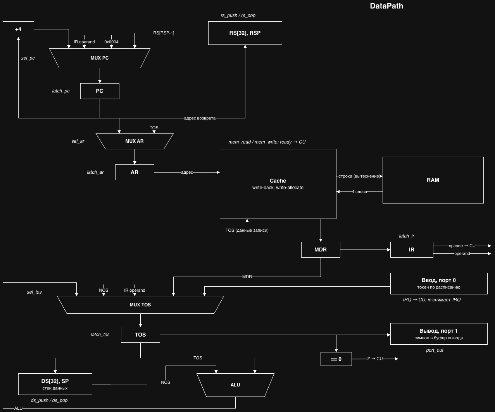
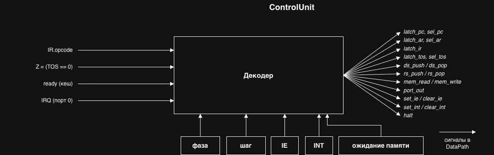

# Лабораторная работа №4. Транслятор и модель процессора

- Погорельченко Фёдор, `<P3212>`
- `alg | stack | neum | hw | trap | port | pstr | cache | alg1`
- С усложнением: `cache`

## Язык программирования alg

Императивный язык с одним типом данных: 32-битное целое со знаком.

### Синтаксис (EBNF)

```ebnf
program     = { global_let | function } ;
global_let  = "let" ident ( "[" number "]" | [ "=" constant ] ) ";" ;
constant    = [ "-" ] number | char | string ;
function    = ( "fn" | "interrupt" ) ident "(" [ ident { "," ident } ] ")" block ;

block       = "{" { statement } "}" ;
statement   = "let" ident ( "[" number "]" | [ "=" expression ] ) ";"
            | if_stmt
            | "while" "(" expression ")" block
            | "return" [ expression ] ";"
            | ( ident | index ) "=" expression ";"
            | expression ";"
            | block ;
if_stmt     = "if" "(" expression ")" block [ "else" ( block | if_stmt ) ] ;

expression  = or ;
or          = and { "||" and } ;
and         = bit_or { "&&" bit_or } ;
bit_or      = bit_xor { "|" bit_xor } ;
bit_xor     = bit_and { "^" bit_and } ;
bit_and     = equality { "&" equality } ;
equality    = relation { ( "==" | "!=" ) relation } ;
relation    = shift { ( "<" | "<=" | ">" | ">=" ) shift } ;
shift       = sum { ( "<<" | ">>" ) sum } ;
sum         = product { ( "+" | "-" ) product } ;
product     = unary { ( "*" | "/" | "%" ) unary } ;
unary       = ( "-" | "!" | "~" ) unary | postfix ;
postfix     = primary { "[" expression "]" } ;
primary     = number | char | string | ident | call | "(" expression ")" ;
call        = ident "(" [ expression { "," expression } ] ")" ;
index       = postfix "[" expression "]" ;

number      = digit { digit } | "0x" hex_digit { hex_digit } ;
char        = "'" symbol "'" ;
string      = '"' { symbol } '"' ;
symbol      = <любой символ, кроме кавычки и перевода строки> | "\" ( "n" | "t" | "r" | "0" | '"' | "'" | "\" ) ;
ident       = ( letter | "_" ) { letter | digit | "_" } ;
```

Комментарий: `// ...` до конца строки.

### Семантика

- Вычисления строгие, операнды и аргументы вычисляются слева направо. Приоритеты
  задаёт грамматика, все бинарные операции левоассоциативны. `&&` и `||` вычисляются
  коротко и дают 0 или 1.
- Арифметика по модулю 2^32. `/` и `%` округляют к нулю, знак остатка равен знаку
  делимого. `>>` логический, величина сдвига берётся по модулю 32. Деление на ноль
  останавливает процессор.
- Строка и массив в выражении дают адрес первого слова, `x[i]` читает слово по адресу
  `x + 4 * i`. Строка хранится как pstr: слово длины, затем по символу на слово.
- Переменные объявляются `let`. Без инициализатора скаляр и массив равны 0. Глобальный
  инициализатор только константа (кладётся в образ памяти), локальный вычисляется при
  каждом выполнении `let`.
- Области видимости две: глобальная и функция целиком (вложенные блоки областей не
  создают). Повторное объявление в одной области запрещено, локальное имя перекрывает
  глобальное.
- Точка входа `main`. Аргументы передаются через стек данных, результат возвращается на
  вершине стека, без `return` функция возвращает 0. Локальные переменные размещены
  статически, поэтому рекурсия запрещена (проверяется транслятором).
- `interrupt name() { ... }`: обработчик прерывания, не больше одного, без параметров и
  результата. При его наличии прерывания разрешаются перед вызовом `main`. Вызвать его
  явно нельзя, общие с `main` функции запрещены.
- Встроенные `in(port)`, `out(port, value)`, `ei()`, `di()` транслируются в одну
  инструкцию. Номер порта должен быть константой.

### Отображение выражений на стек

Сначала код операндов (каждый оставляет на стеке одно значение), затем операция.
`x = a + b * 2;`:

```text
push a ; load          [a]
push b ; load          [a, b]
push 2                 [a, b, 2]
mul                    [a, b*2]
add                    [a+b*2]
push x ; store         []
```

`a[i]` транслируется в `a + (i << 2); load`, `&&`/`||` в условные переходы. Константа
вне диапазона imm24 читается из пула литералов: `push .lit0 ; load`.

## Организация памяти

Фон Нейман: код и данные в одной памяти. Слово 32 бита, адресация байтовая, доступ
только к выровненным словам, 4096 слов. Стек данных и стек возвратов по 32 слова,
в адресное пространство не входят.

```text
+--------------------------------------+
| 0x0000: jmp .start                   |  вектор сброса
| 0x0004: jmp <обработчик> / iret      |  вектор прерывания
| 0x0008: .start: [ei] call main; halt |
|         код функций                  |
+--------------------------------------+
|         секция данных:               |
|           глобальные переменные      |  x
|           локальные переменные       |  f.x
|           массивы                    |  N слов
|           строки (pstr)              |
|           пул литералов              |
+--------------------------------------+

 Стек данных: TOS (регистр) + DS[32], SP     Стек возвратов: RS[32], RSP
```

- Число из диапазона imm24 кодируется в операнде `push`, остальные лежат в пуле
  литералов (одинаковые один раз). Строки лежат в секции данных, в коде только их адрес.
- Все переменные и параметры статически размещены в секции данных. Регистров общего
  назначения нет.
- `call` кладёт адрес возврата на стек возвратов, `ret` снимает. Функция в начале
  снимает аргументы со стека в ячейки параметров.
- При прерывании аппаратно сохраняется только PC. Обработчик оставляет стек данных
  таким, каким получил.

## Система команд

- Стековый процессор: операнды на стеке данных, вершина в регистре TOS, под ней NOS
  (`DS[SP-1]`).
- Регистры: `PC`, `IR`, `AR`, `TOS`, `SP`, `RSP`, флаги `IE` и `INT`.
- Память доступна только через `load`/`store`, адрес на вершине стека.
- Ввод-вывод портовый: порт 0 ввод, порт 1 вывод символа.
- Прерывание от устройства ввода проверяется между инструкциями.

### Кодирование

Инструкция занимает одно слово. Бинарный файл: образ памяти с адреса 0, big-endian.

```text
 31      24 23                     0
+---------+-----------------------+
| opcode  |        operand        |
+---------+-----------------------+
```

`operand`: знаковое 24-битное число у `push`, адрес или номер порта у остальных, 0 если
операнда нет.

### Набор инструкций

Выборка: 2 такта (`AR <- PC`, чтение памяти). Обращение к памяти: попадание в кеш
1 такт, промах 11, промах с вытеснением грязной строки 21, без кеша 10. В таблице такты
исполнения при попадании.

| Код | Мнемоника | Действие | Такты |
|-----|-----------|----------|-------|
| 00 | `nop` | | 1 |
| 01 | `halt` | остановка | 1 |
| 10 | `push imm` | `push(imm)` | 1 |
| 12 | `drop` | `pop()` | 1 |
| 20 | `load` | `TOS <- mem[TOS]` | 2 |
| 21 | `store` | `mem[TOS] <- NOS; pop(); pop()` | 3 |
| 30..3F | `add sub mul div mod and or xor shl shr eq ne lt le gt ge` | `NOS op TOS`, результат вместо двух операндов, сравнения дают 0/1 | 1 |
| 40 | `neg` | `TOS <- -TOS` | 1 |
| 41 | `not` | `TOS <- ~TOS` | 1 |
| 50 | `jmp addr` | `PC <- addr` | 1 |
| 51 | `jz addr` | `if TOS == 0: PC <- addr`; `pop()` | 1 |
| 52 | `call addr` | `RS.push(PC); PC <- addr` | 1 |
| 53 | `ret` | `PC <- RS.pop()` | 1 |
| 60 | `in port` | `push(port)`, снимает запрос прерывания | 1 |
| 61 | `out port` | `port <- TOS; pop()` | 1 |
| 70 | `ei` | `IE <- 1` | 1 |
| 71 | `di` | `IE <- 0` | 1 |
| 72 | `iret` | `PC <- RS.pop(); IE <- 1; INT <- 0` | 1 |

Вход в прерывание: отдельный такт `RS.push(PC); PC <- 0x0004; IE <- 0; INT <- 1`.

## Транслятор

```text
python translator.py <source.alg> <target.bin> [<target.ast>]
```

Создаёт `target.bin`, листинг `target.bin.hex` и, если указан, AST.

1. Лексер ([lexer.py](lexer.py)): текст в токены.
2. Парсер ([parser.py](parser.py)): рекурсивный спуск, AST.
3. Проверка графа вызовов: неопределённые функции, рекурсия, обработчик прерывания.
4. Генерация кода ([translator.py](translator.py)): инструкции с метками, секция данных.
5. Компоновка: адреса меток, затем кодирование.

Листинг: `<address> - <HEXCODE> - <mnemonic> ; <строка исходника>`:

```text
0x0000 - 50000008 - jmp 0x0008 (.start)          ; reset vector
0x0004 - 50000014 - jmp 0x0014 (on_input)        ; interrupt vector
0x0008 - 70000000 - ei                           ; start: enable interrupts
0x000C - 520000CC - call 0x00CC (main)           ; start
0x0010 - 01000000 - halt                         ; start
0x0014 - 60000000 - in 0                         ; 8: buf[tail & 15] = in(0);
0x0018 - 10000110 - push 0x0110 (buf)            ; 8: buf[tail & 15] = in(0);
...
0x0110 - 00000000 - data                         ; buf: array [16]
```

## Модель процессора

```text
python machine.py <target.bin> <input> [--no-cache]
```

- `<input>`: расписание ввода `[(tick, token), ...]`, токен символ или число. В такт
  `tick` устройство защёлкивает токен и выставляет запрос прерывания.
- `--no-cache`: режим без кеша. Журнал пишется за первые 1000 тактов.
- Если рядом лежит `<target.bin>.hex`, журнал подписывается строками исходника.

[machine.py](machine.py), кеш и память: [cache.py](cache.py).

### DataPath



| Сигнал | Действие |
|--------|----------|
| `latch_pc` + `sel_pc` | `PC <- PC + 4 / IR.operand / RS[RSP-1] / 0x0004` |
| `latch_ar` + `sel_ar` | `AR <- PC / TOS` |
| `latch_ir` | `IR <- MDR` |
| `latch_tos` + `sel_tos` | `TOS <- ALU / NOS / IR.operand / MDR / порт ввода` |
| `ds_push` / `ds_pop` | `DS[SP] <- TOS, SP++` / `SP--` |
| `rs_push` / `rs_pop` | `RS[RSP] <- PC, RSP++` / `RSP--` |
| `mem_read` / `mem_write` | `MDR <- mem[AR]` / `mem[AR] <- TOS` через кеш, ответ `ready` |
| `port_out` | `порт вывода <- TOS` |
| `set_ie` / `clear_ie`, `set_int` / `clear_int` | флаги `IE` и `INT` |

В коде сигналы такта: класс `Signals`. Все защёлки срабатывают по одному фронту,
новые значения вычисляются из состояния до такта.

### ControlUnit

Hardwired: конечный автомат и комбинационный декодер.



Сигналы шагов `exec` по опкодам: `execute_steps` в [machine.py](machine.py).

### Кеш

Общий для кода и данных: 16 наборов, 2 пути, строка 4 слова. LRU, write-back,
write-allocate. Адрес делится на `tag | set | offset`. При промахе вытесняется
невалидная или давно неиспользованная строка, грязная сначала пишется в память.

### Журнал и ввод

- После каждого такта в журнал пишутся регистры, фаза, адрес и строка исходника
  инструкции, события ввода-вывода, кеша и прерываний, флаг `INT`.
- Устройство ввода хранит один токен. Новый токен до чтения предыдущего затирает его
  (`input overrun`). Запрос при `IE = 0` ждёт `iret` / `ei`.
- Остановка по `halt` или по лимиту тактов. Ошибки (стеки, деление на ноль, доступ к
  памяти, неизвестная инструкция) останавливают модель с сообщением.

Журнал `cat`, ввод `[(50, 'H'), (1050, 'i'), (2050, 0)]`:

```text
TICK:     49 | 0x005C exec 2 | PC: 0x0060 AR: 0x0150 IR: load        TOS: 336 NOS: 0 SP: 1 RSP: 2 IE: 1 INT: 0 | mem read 0x0150: miss set 5 way 1, fill 0x0150, wait memory (10 left) ; 13: while (head == tail) {
TICK:     50 | 0x005C exec 2 | PC: 0x0060 AR: 0x0150 IR: load        TOS: 336 NOS: 0 SP: 1 RSP: 2 IE: 1 INT: 0 | input 'H' -> IRQ, wait memory (9 left) ; 13: while (head == tail) {
...
TICK:     59 | 0x005C exec 2 | PC: 0x0060 AR: 0x0150 IR: load        TOS: 0 NOS: 0 SP: 1 RSP: 2 IE: 1 INT: 0 ; 13: while (head == tail) {
TICK:     60 | 0x005C irq    | PC: 0x0004 AR: 0x0150 IR: load        TOS: 0 NOS: 0 SP: 1 RSP: 3 IE: 0 INT: 1 ; 13: while (head == tail) {
TICK:     61 | 0x0004 fetch  | PC: 0x0004 AR: 0x0004 IR: load        TOS: 0 NOS: 0 SP: 1 RSP: 3 IE: 0 INT: 1 ; interrupt vector
TICK:     62 | 0x0004 read   | PC: 0x0008 AR: 0x0004 IR: jmp 0x0014  TOS: 0 NOS: 0 SP: 1 RSP: 3 IE: 0 INT: 1 | mem read 0x0004: hit set 0 way 0 ; interrupt vector
```

## Тестирование

Golden-тесты: [golden_test.py](golden_test.py), по YAML на тест в [golden/](golden),
программы в [examples/](examples). Проверяются AST, бинарный образ, листинг, вывод,
журнал первых 300 тактов и вывод без кеша.

| Тест | Что проверяет |
|------|---------------|
| [hello](golden/hello.yml) | вывод строки из секции данных |
| [cat](golden/cat.yml) | эхо ввода до `'\0'` |
| [hello_user_name](golden/hello_user_name.yml) | чтение строки и вывод |
| [sort](golden/sort.yml) | ввод чисел, сортировка вставками |
| [double](golden/double.yml) | 64-битная арифметика: Фибоначчи до F(93) |
| [is_prime](golden/is_prime.yml) | alg1: проверка на простоту |
| [format_string](golden/format_string.yml), [_align](golden/format_string_align.yml) | alg1: `%d`, `%Nd`, `%-Nd`, -2^31 |
| [_overflow](golden/format_string_overflow.yml), [_too_long](golden/format_string_too_long.yml) | alg1: число вне int32, формат длиннее 0x20 |
| [linear_filter](golden/linear_filter.yml) | кеш: КИХ-фильтр по массиву |
| [interrupts](golden/interrupts.yml) | прерывания, ожидающий запрос, `di()`/`ei()` |
| [expressions](golden/expressions.yml) | приоритеты, деление, сдвиги, пул литералов, `&&`/`||` |

`make all`: форматирование, линтеры, тесты. `make update-golden`: обновить эталоны.
CI ([ci.yml](.github/workflows/ci.yml)): `ruff format --check`, `ruff check`,
`mypy --strict`, `pytest` с покрытием.

### Кеш и время выполнения

Обращения = попадания + промахи. Кроме `hello` и `expressions`, программы ждут ввода
по расписанию, поэтому их время зависит и от него.

| Программа | Инструкций | Тактов с кешем | Тактов без кеша | Промахи / обращения |
|-----------|-----------:|---------------:|----------------:|--------:|
| hello | 377 | 1 405 | 5 629 | 15 / 486 |
| expressions | 3 323 | 12 248 | 47 833 | 122 / 4 095 |
| sort | 4 683 | 18 080 | 47 386 | 221 / 5 942 |
| linear_filter | 8 419 | 35 609 | 77 712 | 680 / 10 749 |
| is_prime | 2 963 | 15 292 | 40 587 | 515 / 3 727 |
| double | 56 486 | 292 226 | 824 146 | 9 732 / 70 932 |

### Пример использования

```text
$ cat input.txt
[(50, 'H'), (1050, 'i'), (2050, 0)]
$ python translator.py examples/cat.alg cat.bin cat.ast
source LoC: 26 code instr: 68 data words: 20
$ xxd cat.bin | head -2
00000000: 5000 0008 5000 0014 7000 0000 5200 00cc  P...P...p...R...
00000010: 0100 0000 6000 0000 1000 0110 1000 0154  ....`..........T
$ python machine.py cat.bin input.txt 2> log.txt
Hi
instructions: 618 ticks: 2234 cache: hits 771 misses 19
$ python machine.py cat.bin input.txt --no-cache 2> /dev/null
Hi
instructions: 191 ticks: 2810 cache: off
```
